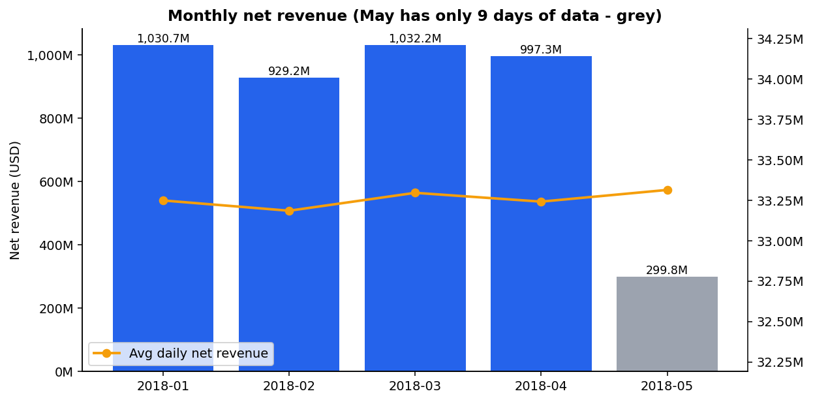
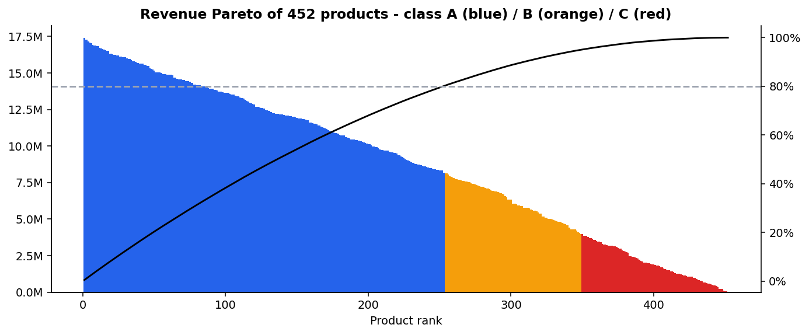
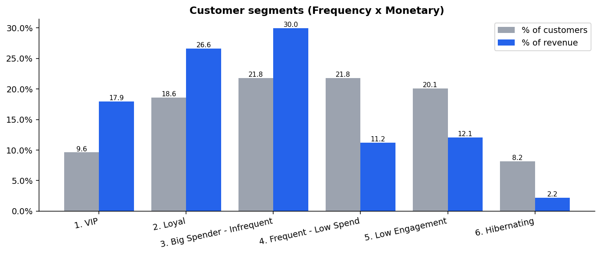
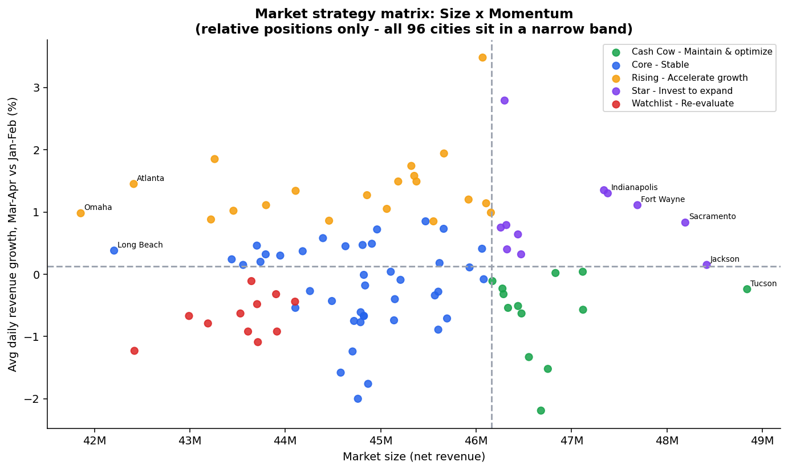

# Grocery Sales Analysis (2018)

End-to-end sales analysis of **6.76 million transactions** from a US grocery retailer (Jan – May 2018), built with **MySQL** and **Python**. It answers five business questions about revenue, products, customers, sales staff and markets, and turns the answers into sized recommendations.

**Highlights**
- 44 analytical SQL queries (CTEs, window functions, NTILE, ROLLUP, z-scores) run by an automated Python pipeline that exports every result to CSV.
- 14 report charts plus an interactive Tableau Public dashboard.
- A data validation step that shows the dataset is unusually uniform, and that the "top vs bottom employee" gap (<1.2%) is noise.
- Cut the slowest query from 161 s to 4.9 s (33×) with a covering index, verified with `EXPLAIN ANALYZE`.
- Recommendations tied to the evidence behind them, with an illustrative impact for each.

> **Dashboard:** _[add your Tableau Public link here]_ &nbsp;·&nbsp; **Full report:** [PDF](outputs/Grocery_Sales_Analysis_Report.pdf) · [Word](outputs/Grocery_Sales_Analysis_Report.docx)

---

## Business questions

| # | Question | SQL |
|---|---|---|
| 1 | How did revenue develop by month, day and category? | [`01_revenue_timeline.sql`](SQL/01_revenue_timeline.sql) |
| 2 | Which products drive revenue, and does product Class matter? | [`02_product_analysis.sql`](SQL/02_product_analysis.sql) |
| 3 | Which customer segments matter most? | [`03_customer_behavior.sql`](SQL/03_customer_behavior.sql) |
| 4 | Who are the top and bottom sales employees, and are they consistent? | [`04_employee_kpi.sql`](SQL/04_employee_kpi.sql) |
| 5 | How is revenue spread across 96 cities, and where should we invest? | [`05_geo_analysis.sql`](SQL/05_geo_analysis.sql) |

## Pipeline

```
data/raw/*.csv ──► 00_import_data.py ──► MySQL (7 tables)
                                            │
                     00_build_fact_sales.sql▼  (revenue computed, 1 flat fact table, reconciled 100%)
                                        fact_sales
                                            │
             run_analysis.py runs 01–05.sql ▼  (window functions, CTEs, NTILE, ROLLUP, z-scores)
                                     outputs/tables/*.csv
                         ┌──────────────────┼──────────────────────┐
                make_charts.py      impact_scenarios.py   prepare_dashboard_data.py
              outputs/charts/*.png   t6_impact_scenarios     dashboard/data → Tableau
```

**Tools:** MySQL 8 · Python 3 (pandas, SQLAlchemy, matplotlib) · Tableau Public

## Key findings

**1. Revenue is flat and predictable.** Every full month earned USD 33.2–33.3M per day, a difference of less than 0.4%. The February "dip" (−9.9%) is only a 28-day effect.



**2. Price, not demand, drives product revenue.** All 452 products sell 174k–184k units (CV 0.9%). Price explains revenue almost perfectly (r = 0.9998). It takes 56% of products to reach 80% of revenue, so there is no 80/20 effect.



**3. Half the customers generate three quarters of revenue.** The VIP, Loyal and Big Spender segments are 50% of customers and 74.5% of revenue. "Frequent – Low Spend" customers order as often as VIPs but spend USD 301 per order versus USD 1,035.



**4. Employee rankings are noise.** All 23 employees are within −1.1% / +0.9% of the team average, and monthly ranks swing from 1st to 21st.

**5. Markets are evenly spread.** City revenue varies by 3.1% (HHI = 104, the minimum possible for 96 cities). Bigger cities simply have more customers (r = 0.84); revenue per customer varies by only 1.7%.



## Data validation

Before trusting the results, I checked whether the patterns could be real. Several signals show the data is far more uniform than real retail data:

| Check | Result | Source table |
|---|---|---|
| Order quantity distribution | Each quantity from 1 to 25 appears in **4.0% ± 0.01%** of orders | `t3_3_basket_size_distribution` |
| Customer activity | **100%** of 98,759 customers bought in every one of the 4 full months; no one-time buyers | `t3_2_active_months_distribution` |
| Units per product | Coefficient of variation only **0.9%** across 452 products | `t2_2_correlation` |
| Market concentration | HHI = **104.3**, theoretical minimum for 96 cities is 104.2 | `t5_3_board_kpis` |
| Employee territory | Only **~1%** (= 1/96) of each employee's revenue comes from their own city | `t5_3_office_performance` |
| Data quality | `TotalPrice` = 0 on all rows → revenue rebuilt from Quantity × Price × (1 − Discount); 1.0% of rows have no date; 0 rows lost in joins | `t0_fact_reconciliation` |

**Why it matters:** in data like this, small differences (for example a 1% gap between employees) are random variation. Rewarding staff on them would be a mistake. The analysis therefore reports differences only together with their size, and it flags where a ranking is not meaningful.

## Recommendations and illustrative impact

Each recommendation rests on a finding above. Impact is a what-if illustration of the method at a **10% change** (range 5–15%), computed by [`impact_scenarios.py`](python/impact_scenarios.py) — not a forecast, because the data appears simulated (see Data validation).

| # | Recommendation | Evidence | Illustrative impact (10% change) |
|---|---|---|---|
| 1 | Upsell the "Frequent – Low Spend" segment (raise order value) | Orders as often as VIPs, but USD 301 vs USD 1,035 per order | ~USD 49M, ~1% of revenue |
| 2 | Grow the customer base in every city | City revenue follows customer count (r = 0.84); revenue per customer varies only 1.7% | ~10% of revenue per +10% customers |
| 3 | Review pricing of ABC class C (lowest-revenue) products; A/B test any change first | 23% of units but 5% of revenue; each product has one price, so price sensitivity cannot be measured from this data | ~USD 20M, ~0.5% of revenue (untested) |
| 4 | Replace revenue-only staff rankings with KPIs staff can influence | Whole team within ±1.1% of the average; monthly ranks swing from 1st to 21st | Avoids decisions based on noise |
| 5 | Monitor retention of the VIP, Loyal and Big Spender segments once longer data is available | 74.5% of revenue; every customer bought in every month, so no churn is observed yet | – |

The city groups in the market strategy matrix (Star, Rising, …) are relative positions inside a very narrow band (growth −2.2% to +3.5%), so they are not used to pick target cities.

## SQL performance

The slowest step (customer metrics, `GROUP BY CustomerID` over 6.76M rows) took 161 s. [`benchmark_sql.py`](python/benchmark_sql.py) times each query before and after adding a covering index and records both execution plans (`EXPLAIN ANALYZE`).

| Query | Covering index | Before | After | Speed-up |
|---|---|---|---|---|
| Customer metrics | `(CustomerID, SalesDay, SalesMonth, ProductID, Quantity, NetRevenue)` | 160.7 s | 4.9 s | **33×** |
| Category × month | `(SalesMonth, CategoryID, SalesDay, Quantity, NetRevenue)` | 25.7 s | 4.5 s | **5.7×** |

The first index takes 7.5 s to build and pays for itself on the first run. Full plans: `outputs/tables/t7_sql_benchmark.csv`.

## Repository structure

```
SQL/                 00_* schema, fact table, validation · 01–05 one file per business question
python/              00_import_data · run_analysis · make_charts · impact_scenarios · benchmark_sql · prepare_dashboard_data
outputs/tables/      one CSV per query
outputs/charts/      14 PNG charts
dashboard/data/      clean extracts for Tableau
```

## How to run

1. Download the dataset: [Grocery Sales Dataset (andrexibiza) on Kaggle](https://www.kaggle.com/datasets/andrexibiza/grocery-sales-dataset). Put the 7 CSV files in `data/raw/`.
2. Copy `python/.env.example` to `python/.env` and fill in your MySQL settings.
3. Run:
   ```bash
   pip install -r requirements.txt
   mysql -u root -p < SQL/00_create_schema.sql
   python python/00_import_data.py
   python python/run_analysis.py --build      # fact table + all analyses (takes several minutes)
   python python/make_charts.py
   python python/impact_scenarios.py
   python python/prepare_dashboard_data.py
   python python/benchmark_sql.py             # optional
   ```

## Limitations

- Only 129 days of data, so yearly seasonality cannot be assessed.
- No product cost data, so the analysis measures revenue, not profit.
- Every order contains one product line, so basket (market-basket) analysis is not possible.
- The data appears simulated (see Data validation). The method transfers to real data, but the specific numbers should not be read as real business results.

